# Rumbo · a trip that saves itself while you play
*by EmpowerTours*

**Rumbo** is the traveler app from EmpowerTours ("rumbo" means *heading, direction*: *¿a dónde vas?*). Its planned home is **rumbo.empowertours.xyz**, but only **after Nov 3**: nothing is deployed, no domain or DNS has been set up, and nothing has been pushed. Smart-contract names stay `EmpowerTours …` (EIP-712 domains and `TripVault`, `Tickets`, … are unchanged), and the working folder is still `/workspace/tours-loop`.

> **Local prototype only.** It runs on Monad **Solonet** on this box (`http://localhost:8080`, chain 20143) with mock USDC and public test accounts. It has no remote and has not been deployed anywhere public. Nothing touches mainnet. We're holding off on anything public until Monad Metropolis results come out (Nov 3).

With Rumbo you pick a dream trip, for example **"Oaxaca, March, 500 USDC."** That opens a trip vault, and you sign a leash for it, the same way you sign one in Cota. After that you just go out. Each day there are nearby stops: a Hunt GPS cache, a local guide's meeting point, an artist's mural or show. Each visit that's proved sends a bit of USDC from that stop's sponsor straight into your trip fund, plus some **$TOURS** points. Friends can chip in too, and the money earns interest while it waits. The app keeps you posted: *"Oaxaca 64% funded, 12-day streak."* Once the trip starts, the vault books your guide and your stay. That money sits in escrow until you check in, and if the host cancels, it comes back to you automatically. When the trip is over, you anchor reviews that can't be edited later.

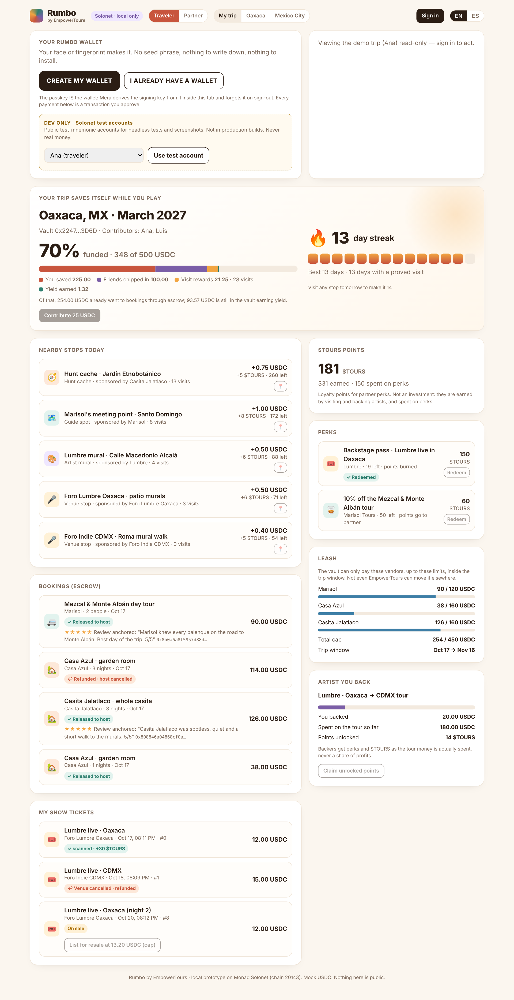

| ES desktop | EN mobile | ES mobile |
|---|---|---|
| 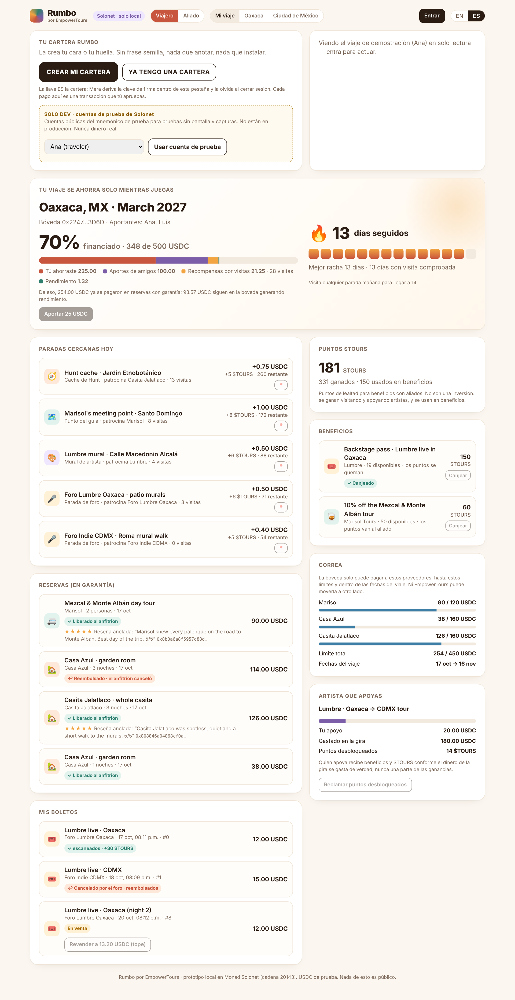 | 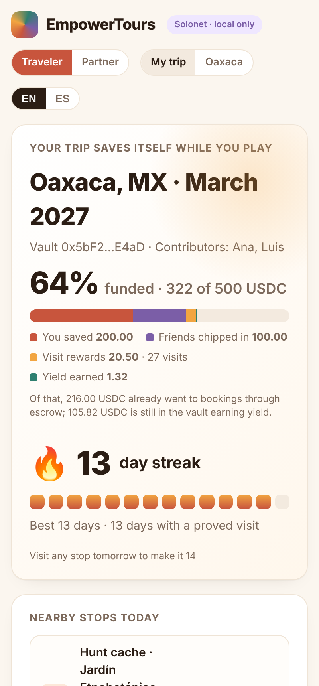 | 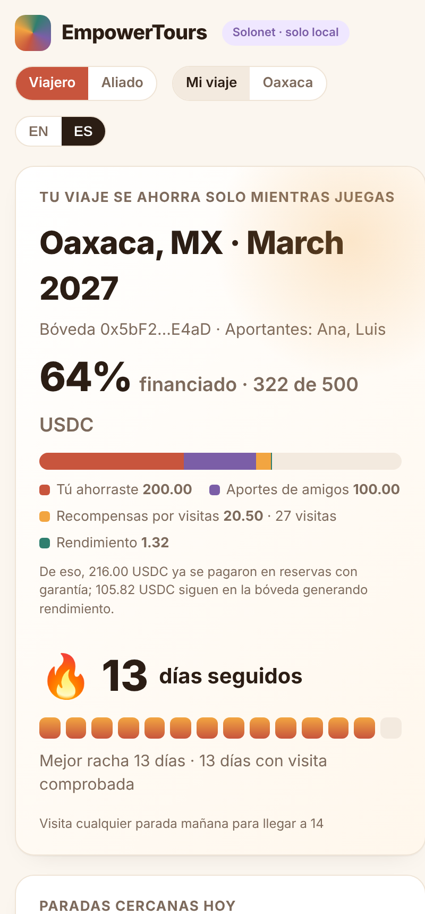 |

**Round 2: venues, tickets, batched check-ins.** Venues are now a third kind of partner. An artist's tour fund books venues through escrow (and only venues on its leash). Fans buy tickets into escrow, and after the show the money splits automatically. A ticket scan counts as a check-in, so it earns $TOURS and keeps the streak going. Check-ins can now be claimed in one transaction per day or per batch.

| Destination page (EN) | Partner · venue (ES) | Partner · artist (EN) |
|---|---|---|
| 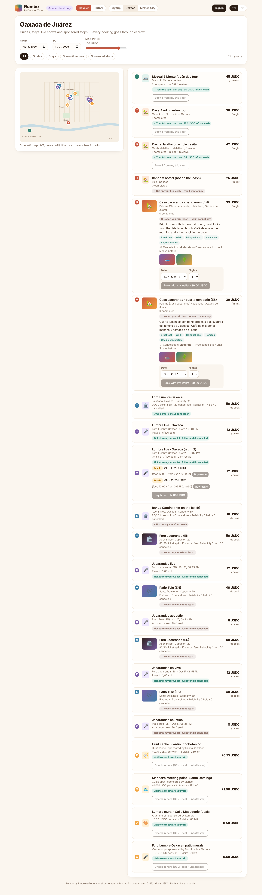 | 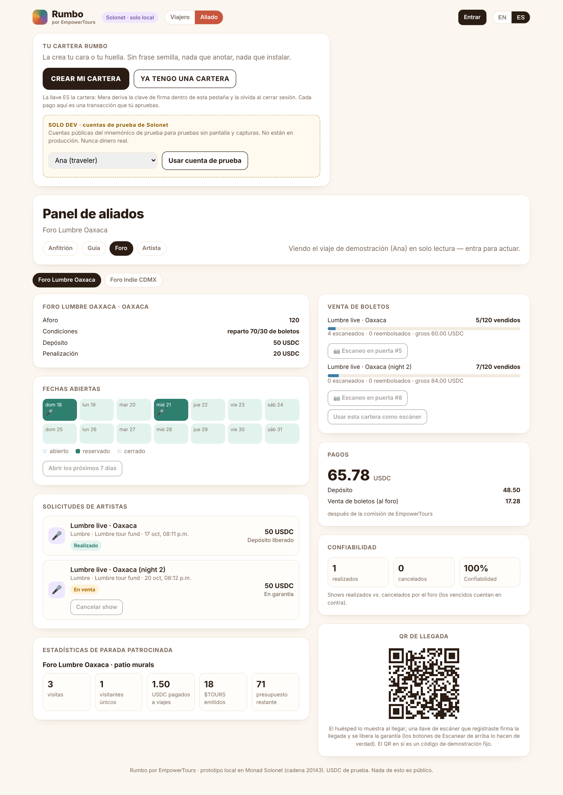 | 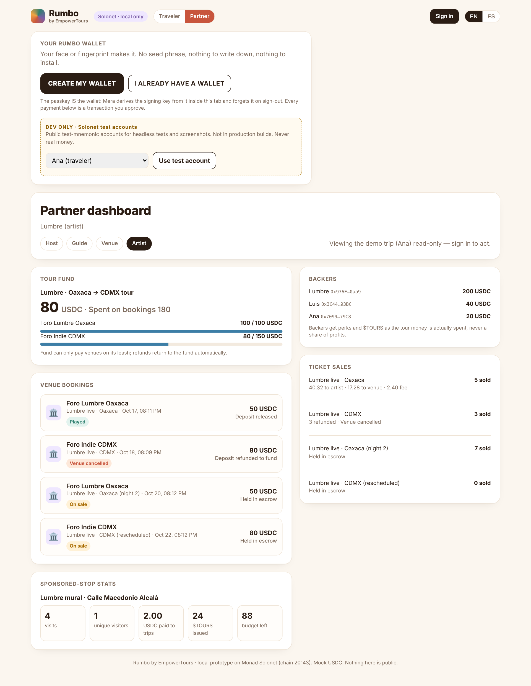 |

**Round 3: a real wallet (Mera passkey, same model as Hunt), per-venue scanner keys, ticket resale, CDMX.** The UI now signs real Solonet transactions. The account layer is the **passkey itself**: Mera derives the signing key from the passkey's PRF output, so there's no seed phrase, no extension and no email. Every former MOCK button is now a contract call with pending, confirmed and error states. Venues and hosts register their own door/check-in scanner keys. Tickets can be resold, capped at 110% of face, with an artist royalty and the EmpowerTours fee, and they can't be passed to non-holders once doors open. The destination pages are driven by data (Oaxaca and Mexico City).

| Passkey wallet on the dashboard (EN) | Real ticket purchase (ES) | Resale listing (EN) | CDMX destination (ES) |
|---|---|---|---|
| 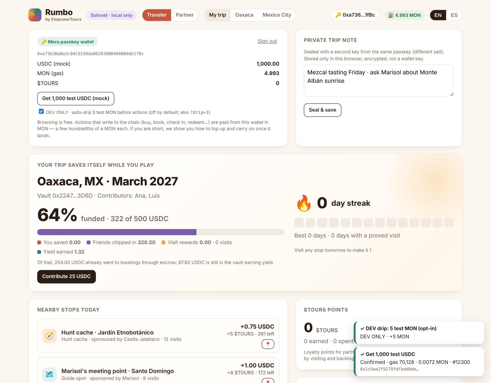 | 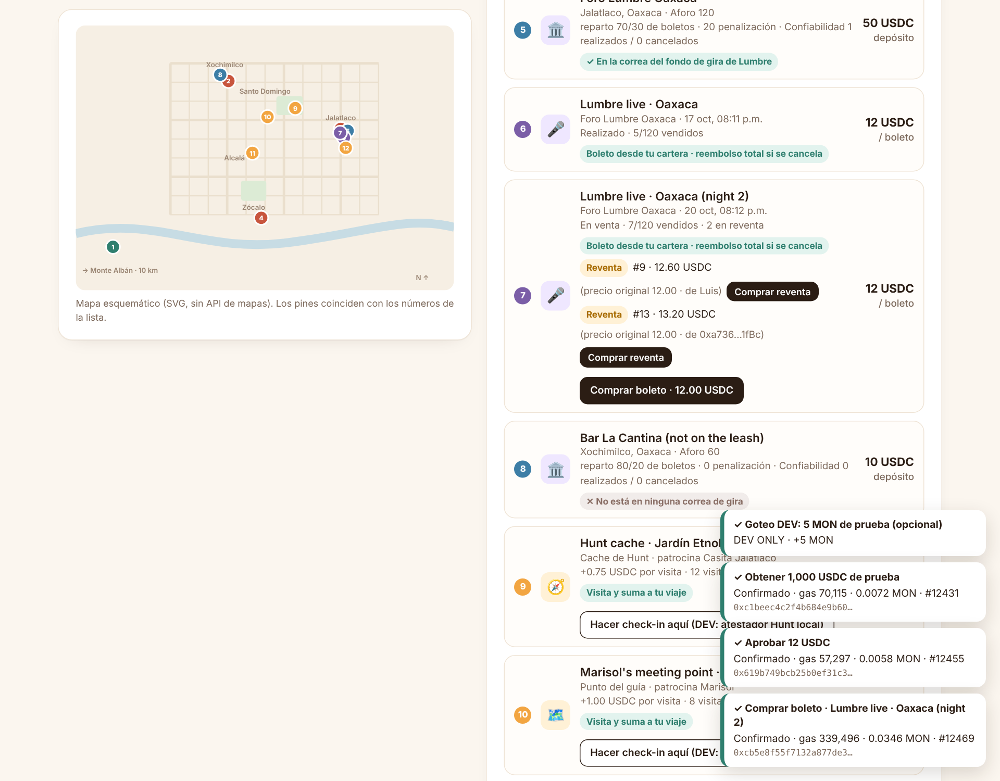 | 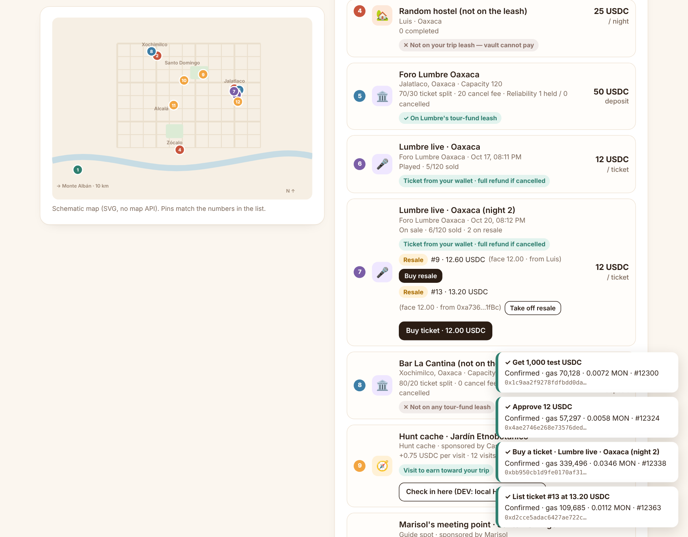 | 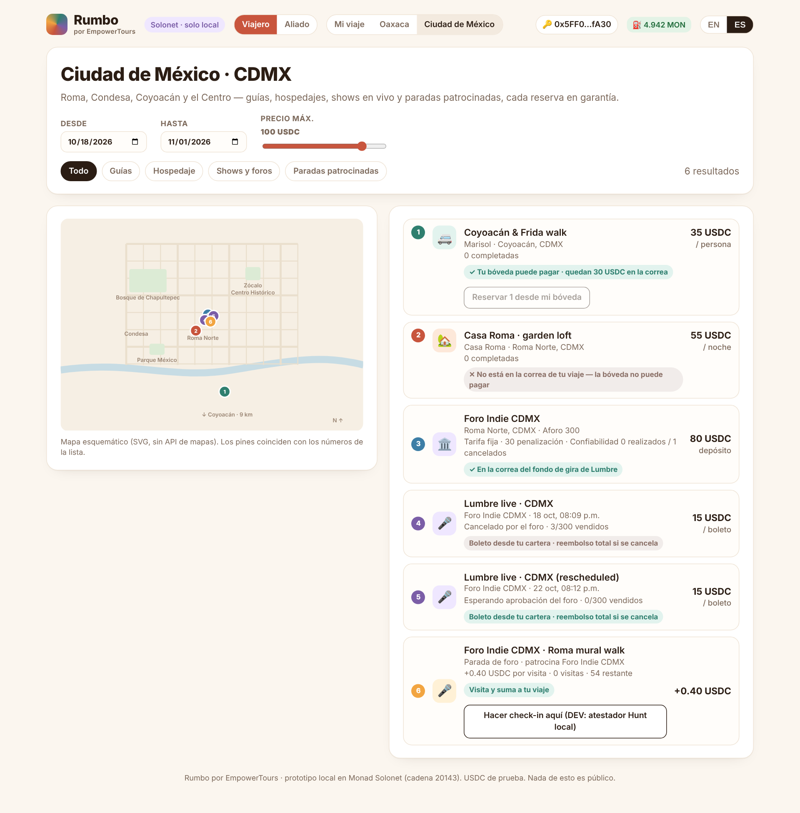 |

---

## The loop

```
 sponsors (guides, hosts, artists) ──fund stops──▶ TourRewards ──10% fee──▶ treasury
                                                     │  EIP-712 visit proof (Hunt GPS attester)
             proved visit ─────────────────────────▶ ├─ USDC ─────────▶ TripVault (traveler's) ──▶ MockLendingPool (yield)
                                                     └─ $TOURS (mint, daily-capped) ──▶ PerkMarket (burn / to partner)
 friends ──chip in──▶ TripVault                                         ▲
                       │ (artist tour fund) bookVenue() ──▶ Venues escrow ──venue QR attestation──▶ venue (−3% fee)
                       │                                         └─ venue cancels / show expires ──▶ full refund to fund, leash restored
                       │                                         └─ artist cancels ──▶ cancel fee to venue, rest to fund
 fans ──buy()──▶ Tickets escrow ──show Played → settle()──▶ fee 4% ▶ treasury · venue share · artist rest
                       │          └─ show cancelled ──▶ refund / refundAll (anyone) · scan() ──▶ TourRewards.sourceCheckIn ($TOURS + streak)
                       │ leash: approved vendors · per-vendor caps · total cap · trip window
                       └─ book() ──▶ Bookings escrow ──release (check-in / attestation)──▶ host (−3% fee ▶ treasury)
                                                     └─refund (host cancel / no-show timeout)──▶ back to vault, cap restored
                                                     └─ anchored review (rating + keccak256(text))
```

## Contracts (`contracts/src`, Foundry, Solidity 0.8.28, via-IR, cancun)

| Contract | What it does |
|---|---|
| `TripVaultFactory` | Opens vaults as EIP-1167 clones. It's also the registry the other contracts use to tell real vaults from fakes. The owner lists the allowed assets and one yield adapter per asset. `bookings`/`rewards` wiring can be written once, and so can `wireVenues`. |
| `TripVault` | Holds the money for one trip, or one artist tour (`Kind.ArtistTour`). Goal, destination, start and end. Solo or group contributions, with ERC4626-style virtual shares and principal tracked per contributor. Idle money goes to the yield adapter automatically. **Leash:** only the owner or a delegated `agent` (a Cota-style agent) can spend, only during the trip window, only to approved vendors, within each vendor's cap and the total cap. Tightening takes effect right away. Loosening waits `LEASH_DELAY` (1 day), and anyone who contributed before a loosening can exit. Cancelling, or reaching the end with no open bookings, lets each contributor withdraw their pro-rata share plus yield. |
| `IYieldAdapter` + `mocks/MockLendingPool` | The interface a real Neverland (Aave fork) or Morpho adapter would implement. The mock uses an Aave-style liquidity index at a set APR, paid from a seeded reserve. `fastForward()` is a **demo-only** knob because Solonet can't warp time. |
| `TourRewards` | **Proof of visit.** Sponsors fund campaigns: per-visit reward (USDC, or WMON for MON-denominated stops), $TOURS per visit, budget, location id and daily cap. A platform fee is taken on funding. An allowlisted attester signs each visit with **EIP-712** (a stand-in for Hunt's GPS check), and the traveler submits it from their own wallet (the contract accepts it from any sender, but the product has no gas sponsorship). Rewards go **straight into the traveler's own vault**, or to their wallet if the vault is closed. **No double rewards:** each visit id is single-use, and a user gets one claim per campaign per UTC day. Late claims are accepted for up to 14 days, never for the future. **Streaks:** across all stops, the first visit of each consecutive day earns a bonus of `streakBonus × min(streak−1, 10)` $TOURS. **Batched claims (round 2):** `claimBatch(VisitBatch{user, vault, campaignIds[], visitedAts[], batchId}, sig)` takes one attester signature for up to 64 visits in time order. It walks the streak in memory and writes it once, then makes one vault deposit and one $TOURS mint. Each visit still gets its own `VisitRewarded` event (visitId = keccak(batchId, i)), and the per-(user, campaign, day) claims are now a bitmap. **Check-in sources:** contracts allowlisted by the owner (Tickets) can call `sourceCheckIn` to award $TOURS and a streak day without USDC. **Artist backing:** backers of an ArtistTour vault unlock $TOURS in proportion to how much of the tour money has actually been spent, so depositing and then cancelling earns nothing. |
| `Bookings` | Guides and hosts list tours and stays. `book()` pays the exact quote into escrow, with `maxAmount` front-run protection. **Release:** the traveler confirms check-in, or an attester's EIP-712 check-in proof is submitted (by the host, say), so a traveler can't hold the payout hostage. **Refund:** the host cancels, the traveler cancels inside the free-cancellation window, or **anyone** claims a refund after `startAt + noShowTimeout`. Fee and timeout are snapshotted at booking time (fee max 5%, demo 3%). The vault callback runs inside try/catch with a gas guard, and `syncBooking()` is a backstop, so resolving an escrow never depends on the vault. **Review anchoring:** after a release, one review per booking (rating plus a hash of the text), only from the payer or the vault owner. |
| `Venues` *(round 2)* | Venues list capacity, terms and location. Terms are a ticket split (`venueTicketBps`, e.g. 3000 = 70/30 artist/venue) or a flat fee (bps 0), plus a deposit and a cancellation fee. Venues mark open UTC days (`setOpenDates`), and each day can hold only one booking. `bookShow` pulls the deposit into escrow, snapshotting the terms and fee and checking `maxDeposit`. **Outcomes:** `confirmShow` takes the attester's `ShowAttestation(showId, outcome=1, at)` from the venue's door QR and releases the deposit minus 3% to the venue. `venueCancel` gives a full refund. `artistCancel` (before showtime) sends the cancel fee to the venue and refunds the rest. `claimArtistNoShow` (outcome 2) lets the venue keep the cancel fee. `expire` lets anyone refund in full after `showTime + resolveTimeout` (3 days) if nobody attested, and counts it against the venue. **Reliability:** `reliability(id)` returns (held, cancelled, bps). The vault callback uses the same gas guard and try/catch as Bookings, with `syncShow` as a backstop. |
| `Tickets` *(round 2)* | Fans `buy(showId, qty ≤ 20, maxTotal)` while the show is Booked and before showtime. The money goes into escrow, and the fee (4%, max 10%) is snapshotted at the first sale. `scan(ticketId, at, sig)` takes an attester-signed `TicketScan` between showtime − 6 h and showtime + 1 day. It marks the ticket used (**no double use**) and calls `TourRewards.sourceCheckIn`, so the holder gets `toursPerScan` (10) $TOURS and a streak day. `settle(showId)` (anyone, once the show is Played) splits the money: **the fee first, then the venue's bps share, and the artist gets the rest** (`splitOf`, conserves funds exactly). The artist's share goes to the artist's wallet, not the tour fund, so backers never get a revenue share. For a cancelled show, `refund(ticketId)` / `refundAll(showId, max)` (a cursor, anyone can call it) refund 100%. |
| `ToursToken` ($TOURS) | ERC20 + Burnable. **Only the rewards contract can mint**, and the minter itself has a leash: `mintCapPerDay`. Transferability is configurable (see below). |
| `PerkMarket` | Approved partners list perks priced in $TOURS: supply, per-user limit, and whether redeemed points are **burned** or **sent to the partner**. Redemptions emit `Redeemed(redemptionId, …)`, and the partner honors the perk off-chain. |

### Ideas carried over from `pq-agent-batch`
- **Caps and leash** (AgentRegistry caps → TripVault per-vendor and total caps, plus the agent delegate). Per-epoch caps (audit L-09) → the daily cap on campaigns and on $TOURS minting.
- **Audit L-02** (`_pullExact` balance-delta check): rejects fee-on-transfer and rebasing tokens in vault deposits, escrow and campaign funding.
- **Audit L-01** (the admin could change the fee under a user): booking fee and no-show timeout are snapshotted per booking.
- **Audit L-04** (two-step admin): `Ownable2Step` everywhere.
- **Audit L-05/L-07** (constructor and zero-address checks); **M-01** (one bad party can't brick everyone): escrow resolution can't be blocked by a reverting or gas-starved vault callback.
- Fee pattern: fees accrue to a treasury address (`feesCollected` counters), and refunds are always 100%.
- `ReentrancyGuardTransient` on every function that moves money.

## How it maps to Hunt and Cota

| Piece | Hunt | Cota |
|---|---|---|
| Proof of visit | Hunt's server-side GPS check becomes the **attester** that signs `Visit(user, campaign, vault, visitedAt, visitId)`. Hunt caches become sponsored campaigns (`StopKind.HuntCache`). The traveler submits the signed visit and pays its gas in MON (no sponsorship). | — |
| Leash | — | Same idea as a Cota leash: the user signs limits up front, and every action is checked against them. Instead of market, leverage and size, a trip leash is **vendors, caps and a date window**. `agent` is where a Cota-style AI agent plugs in. It can book on the traveler's behalf, but only inside the leash. |
| Daily loop | Earn on foot → fund a trip. Streaks give people a reason to open the app every day. | Refusals are the product: the demo transcript lists every attempt the contracts refused (before the trip window, a vendor not on the leash, over cap, forged proof, replay). |
| Agent Record (later) | — | A vault's events (deposits, rewards, bookings, refunds, reviews) are exactly what an Agent Record page would show: where every peso went. |

## Wallet: Mera passkey, ported from EmpowerTours Hunt (round 3)

The only account layer is a **Mera passkey wallet**, the same model Hunt uses. `navigator.credentials` runs a WebAuthn ceremony with the PRF extension. Its 32-byte output goes through BIP-39 → `m/44'/60'/0'/0/0` → a secp256k1 key, which lives in a Mera signing session inside the tab. The private key bytes are zeroed right after the session is created, and the session ends on sign-out. Mera's `toViemAccount` signs the transactions and EIP-712 messages, and the UI sends them to Solonet. A second PRF salt yields an AES-GCM key (non-extractable) that seals the **private trip note**. That key is not a wallet key. MetaMask and other injected wallets aren't used at all.

**Reused from Hunt** (`/workspace/empowertours-hunt`, read-only, nothing modified there), copied into `ui/src/auth/`:
- `@category-labs/mera` **0.2.0** (same pin) plus `@scure/bip39` / `@scure/bip32`.
- `derive.js` ← `lib/auth/derive.ts` (PRF → mnemonic → BIP-32 path; the salt label is `empowertours-rumbo/passkey/v1`, renamed from `empowertours-tours/…` before launch and pinned by `ui/src/auth/derive.test.mjs`).
- `credential-id.js` ← Hunt's credential-id validation, verbatim.
- `vault-key.js` ← the second-secret derivation (salt `empowertours-rumbo/passkey/vault/v1`) plus seal/open.
- `passkey.js` ← `lib/auth/mera*`/`passkey.ts`. Ported pieces:
  - the rule that one derivation path serves every entry point;
  - the mera-vs-viem address cross-check;
  - the 60 s ceremony timeout with a 75 s hard guard;
  - the remembered credential in localStorage;
  - the `INPUT_INVALID` retry with a discoverable lookup;
  - the own-relying-party check (an IP host is rejected; passkeys need `localhost` or a real hostname);
  - EN/ES error explanations.
- `signIn.js` ← `signIn.ts`: `NoPasskeyFoundError` with the structural `canCreateWallet` flag, and one in-flight ceremony across both buttons. There's no server, so where Hunt sets a cookie, Rumbo keeps the session in memory.
- `src/signin.js` ← `SignInPanel.tsx` + `SignInPrompt.tsx` UX and copy, EN/ES:
  - **CREATE MY WALLET** (primary) and **I ALREADY HAVE A WALLET**;
  - "Your face or fingerprint makes it. No seed phrase, nothing to write down, nothing to install.";
  - a counting `WAITING… 7s` with the "Still waiting" hint after 6 s;
  - the **"This makes a NEW wallet"** warning next to the create offer after a failed sign-in;
  - "Sign-in not available yet" when the browser has no WebAuthn.

**DEV ONLY fallback** (`ui/src/auth/dev.js`): it's loaded only behind `import.meta.env.DEV`, so `vite build` contains no test mnemonic (checked). It offers the public Solonet test accounts (the demo cast) in a dashed box labelled "DEV ONLY · Solonet test accounts", and `?dev=<actor>` signs in with one for headless runs. It also provides:
- an **opt-in devnet drip**, OFF by default: with `?drip=1` (or the DEV checkbox on the wallet card) test account #19 sends a new wallet 5 MON before its first action. It exists only to speed up dev runs; it is not part of the product, and the zero-MON flow below runs with it off;
- a stand-in for the **Hunt GPS attester**, so the "check in here" buttons can sign a `VisitBatch` locally.

**What each button does** (`ui/src/actions.js`). Each one builds a plan (approvals only when needed), prices it, checks the wallet can pay (see *Gas* below), then per step runs simulate → estimate × 1.10 → sign → wait for the receipt, shows a toast with the hash, gas and MON paid, then re-reads the chain:

| Who | Buttons |
|---|---|
| Traveler | contribute to the trip vault (approve + deposit), check in at a stop (`claimBatch`), redeem a perk (approve $TOURS + `redeem`), buy a ticket, buy a resale ticket, list or unlist a ticket at the cap, book a listing from the vault, confirm arrival (release the escrow), claim backing points, get test USDC (mock token) |
| Host / guide | accept a booking, cancel and refund, register this wallet as the check-in scanner, scan a guest in (the scanner signs `CheckIn`, then `confirmWithAttestation`) |
| Venue | accept or decline a request, cancel a show, open the next 7 days, register this wallet as the door scanner, door-scan the next ticket (the scanner signs `TicketScan`) |

A button is disabled (with the reason as a tooltip) when nobody is signed in or the signed-in wallet isn't the owner. Partner views follow the signed-in wallet when it owns listings or a venue.

**Headless coverage** (`node demo/ui-flows.mjs` → `demo/ui-flows.json`, appended to `demo/transcript.md` §6b): Chromium's CDP **virtual authenticator with `hasPrf: true`** runs the real Mera code. First the zero-MON run (see *Gas* below). Then, with the DEV drip opted in (`?drip=1`), in EN and in ES it creates a passkey wallet, signs out, signs back in with "I already have a wallet" (and gets the **same address**), seals a private note with the second secret, gets test USDC, **buys a ticket** and **lists it for resale at 110%**, all signed by the passkey wallet. DEV accounts then run the partner side: the venue accepts the CDMX request, Casa Azul accepts and scans Ana in, Ana contributes, checks in and redeems a perk, and Sofía buys Luis's resale ticket. A refused redeem (`UserLimit`) was also seen to show its error toast.

**What can't be exercised headlessly:**
- a real platform passkey sheet (Face ID, Touch ID, Android, Windows Hello), cross-device QR / hybrid transport, and iCloud or Google Password Manager sync;
- authenticators that don't support PRF (the virtual one always does);
- the real Hunt GPS attester (the DEV stand-in signs instead);
- funding a wallet from a real exchange or another wallet app (the test harness funds it from a Solonet test account instead).

## Gas: every user pays their own, in MON (no sponsorship)

There is **no gas sponsorship, relayer or paymaster**. Each wallet pays for its own transactions in MON. **Browsing never needs MON**: destination pages, listings, shows, perks, partner dashboards, your own balances and history, and Mera sign-in are all RPC reads. Only buttons that send a transaction need MON.

**Before any write** (`ui/src/actions.js` → `quote()` in `ui/src/auth/wallet.js`):
1. The action builds its steps (e.g. `approve` + `buy`; the approve only if the allowance is short) and makes any signatures it needs.
2. Each step is estimated (`eth_estimateGas` works from a 0-MON account on Monad). A step that depends on an earlier one (the `buy` behind an `approve`) can't be estimated yet, so it uses the measured limit from `ui/src/gas.js`. A revert on the first step is shown as the contract's error.
3. **Monad charges the gas limit**, so the cost is **Σ (estimate × 1.10) × maxFeePerGas**. The fee caps are passed explicitly to every transaction, so this is the most the wallet can be charged.
4. **Reserve balance** ([docs](https://docs.monad.xyz/developer-essentials/reserve-balance)): consensus requires the sum of a sender's in-flight gas fees to fit in min(10 MON, the balance from ~3 blocks earlier). The execution-time "don't dip below the 10 MON reserve" rule only concerns MON *value* sent, and our calls send none. Steps run one at a time, so the rule comes down to **balance ≥ cost**, plus waiting **4 blocks** after a top-up so the lagged balance sees it.
5. If the action spends USDC and the wallet doesn't have it, the user gets a plain "not enough USDC" message (no MON is spent, no top-up sheet).
6. If **balance < cost, nothing is signed or sent.** The **"Top up your wallet" sheet** (`ui/src/topup.js`, EN/ES, Hunt-style copy) opens instead. It shows:
   - the wallet address with a **Copy** button and a **QR code**;
   - the **MON needed** for this action and a **suggested top-up** (+25%, at least +0.01, rounded up to 0.01 MON);
   - the **current balance**, polled every 2 s.

   Once the balance covers the cost (and 4 blocks have passed), the sheet closes and **the action continues by itself**. "Not now" closes it with nothing sent. There are no exchange or on-ramp links.

**Hints, never blocks:** the header shows a small `⛽ 0.000 MON` balance chip (green once it covers a typical action). For a signed-in wallet that can't afford an action, its button shows `~0.054 MON` and stays clickable; clicking it opens the sheet. Navigation is never blocked, and nothing is sent on page load.

**MON shown for common actions** (button hint = typical gas limit × the current 122 gwei max fee; actually charged = limit × the 102 gwei effective price on Solonet):

| Action | Gas limit | Hint (max) | Charged on Solonet |
|---|---:|---:|---:|
| Buy a ticket (approve + buy) | 57,297 + 339,447 | ~0.054 MON | 0.0405 MON (measured) |
| Buy a resale ticket (approve + buyResale) | 57,400 + 316,000 | ~0.046 MON | ≈0.038 |
| Contribute to the trip (approve + deposit) | 57,400 + 271,200 | ~0.041 MON | ≈0.034 |
| Check in at a stop (`claimBatch`, 1 visit) | 520,441 | ~0.064 MON | 0.0531 (measured) |
| Redeem a perk (approve $TOURS + redeem) | 57,400 + 228,320 | ~0.035 MON | 0.0233 without the approve (measured) |
| List a ticket for resale | 109,661 | ~0.014 MON | 0.0112 (measured) |
| Book from the trip vault | 631,000 | ~0.077 MON | ≈0.064 |
| Host: accept a booking / scan a guest in | 76,211 / 496,372 | ~0.010 / ~0.061 MON | 0.0078 / 0.0506 (measured) |
| Venue: accept a show request | 57,028 | ~0.007 MON | 0.0058 (measured) |
| Test USDC faucet (DEV mock token) | 70,128 | ~0.009 MON | 0.0072 (measured) |

The `cancelResale`, `declineShow` and 7-day `setOpenDates` limits in `gas.js` are estimates (60k / 470k / 260k) and weren't measured in the UI.

**Headless zero-MON test** (`node demo/ui-flows.mjs`, part `zero`; results in `demo/ui-flows.json` → `zeroMon` and `demo/transcript.md` §6c). It runs in EN and ES with a fresh Mera wallet from the CDP virtual authenticator holding **0 MON**, with the DEV drip off:
- It visits all 8 routes signed out and all 8 signed in: **0 console errors, 0 transaction attempts** (every `/rpc` POST is watched for `eth_sendRawTransaction`).
- A test account mints it 100 mock USDC. Clicking **Buy a ticket** opens the top-up sheet (needed 0.0534 MON, suggested 0.07, balance 0, QR present), and **no transaction is sent**.
- Test account #19 then sends 0.07 MON. The sheet sees it, waits 4 blocks, and the **approve + buy complete automatically** (57,297 + 339,447 gas; 0.0405 MON actually spent).

Screenshots:
- zero-MON browsing: `screenshots/zero-mon-dashboard-{en,es}.png` and `zero-mon-destination-{en,es}.png`;
- the sheet: `topup-sheet-{en,es}.png`;
- after funding: `topup-funded-confirmed-{en,es}.png` (the toasts) and `topup-funded-dashboard-{en,es}.png`.

## Partner creation flows (round 4)

Everything the demo script used to do for partners now has a real UI (EN/ES, mobile-friendly) and is sent from the signed-in wallet (Mera passkey, or a DEV test account in dev builds). Every write goes through the usual pre-send gas estimate and the top-up sheet. There is no sponsorship, and browsing still needs 0 MON.

| Route | Who | What it does |
|---|---|---|
| `#/create/listing/stay`, `#/create/listing/tour` | host / guide | New listing. Fields: title, description, city (from the destinations data), neighborhood or meeting point, 1–6 photos, price in USDC, capacity (max people or max nights), available dates (28-day picker), cancellation policy, perks. The first listing also saves a host profile (display name and bio), so "registering" is part of the same flow. |
| `#/create/listing/<id>` | that listing's host | Edit (prefilled), pause or resume, delete. Delete is a two-step confirm and is permanent; bookings already in escrow still resolve. |
| `#/partner/host`, `#/partner/guide` | host / guide | My listings with photo, status, Edit / Pause / Delete and "+ New stay / + New tour". Wallets with no listings yet get a "Host or guide on Rumbo" call to action. |
| `#/create/venue` | venue | Venue profile: name, city, place, capacity, photos, deposit, cancel fee, venue share of ticket sales, a manual-approval toggle, open dates, and "use this wallet as my door scanner" (one plan: `listVenueWithMeta` + `setOpenDates` + `setScanner`; the later steps take the new id from step 1's return value). |
| `#/partner/venue/<id>` | venue | As before, plus my venues in the switcher, **Confirm the show happened** (signed with the door key) and, once showtime has passed, **Artist didn't show — file a claim** (`claimArtistNoShow`, using the existing contract logic: the venue keeps the cancel fee, the rest of the deposit goes back to the artist, and every ticket becomes refundable). |
| `#/create/artist`, `#/partner/artist` | artist | Artist profile (name, genre, home city, bio, photo). Browse venues that have open days, and **request a date**: pay the deposit into escrow (`approve` + `bookShow` with no ticket terms yet). My shows show the status (waiting for the venue / accepted / on sale / settled). Once a show is accepted: **put tickets on sale** (price and supply, capped at the venue capacity, with the resale cap and royalty shown), withdraw a request, and **settle** after the show is Played. |
| `#/destination/<city>` | traveler | Listings created in the app show their photo, description, perks, cancellation policy and a **Book with my wallet** box (date from the host's available days, nights or people). Paused and deleted listings are hidden. |

**Validation.** Forms are checked in the browser before anything is uploaded, priced or signed. Errors show inline next to the field (EN/ES), the first bad field is focused, and a toast says how many fields need a look. No transaction is sent and no top-up sheet appears. Checks: lengths, price > 0 with at most 2 decimals, whole-number capacity, at least one photo and one date, JPEG/PNG/WebP up to 4 MB, cancel fee ≤ deposit, venue share 0–100 %, a show time in the future, on a day the venue opened and that isn't taken, and ticket supply ≤ venue capacity. Reverts that still happen are shown in plain words (for example `NotOpen` → "the venue is not open that day").

**Show times** are entered in Mexico City time (UTC−6, the zone the app shows everywhere). The contracts' calendar works in UTC days, so an evening show in CDMX falls on the next UTC day. The open-day chips prefill 17:00 CDMX, which keeps it inside the day the venue opened.

### Photos and metadata: local dev content store (production needs IPFS)

Photos and the listing, venue, artist and host metadata JSON go to a **local, dev-only content store**: a Vite middleware (`ui/content-store.js`) that keeps files in `content-store/<sha256>.<ext>` (git-ignored) and serves `GET /content/<sha256>`. Only the URI `local:sha256:<hex>` goes on-chain (`listingMeta`, `venueMeta`, `hostProfile`, `artistProfile`). The client re-hashes everything it reads and ignores anything that doesn't match. Nothing is uploaded anywhere public, and the store isn't part of the production build (`npm run ui:build` has no `/content` endpoint).

**Production needs IPFS (pinned through a pinning service, `ipfs://<cid>` URIs) or another real content-addressed store.** Swap `put()` / `getJson()` in `ui/src/content.js`; the on-chain side stays the same. If `content-store/` is wiped, metadata simply stops showing (titles, places and prices are on-chain).

### Contract additions (round 4, `Round4.t.sol`, 9 tests)

- `Bookings`: `createListingWithMeta`, `editListing` (host only; existing bookings keep their snapshotted price and window), `removeListing` (permanent), `setHostProfile`, plus `listingMeta`, `removed`, `hostProfile`. `updateListing` (pause/resume) refuses a removed listing.
- `Venues`: `listVenueWithMeta`, `setVenueMeta`, `setArtistProfile`, and `openSales(showId, price, maxTickets, title)`. It is one shot, only for the artist or payer, only while Booked, accepted and before showtime, and supply is capped at capacity. This is what turns a date request (`bookShow` with price 0) into a show on sale.
- Static analysis was rerun (Slither 0.11.6, Aderyn 0.6.8). The triage is in `audits/TRIAGE.md` under "Round 4"; nothing new needs fixing.

### Gas / MON for the new actions (measured by `demo/ui-create.mjs` on Solonet)

Monad charges the **gas limit**. The app sends estimate × 1.1, and the "quoted" column is what the pre-send check and the top-up sheet use: Σ limit × maxFeePerGas (122 gwei). "Paid" is the actual charge at the effective ≈102 gwei.

| Action | Txs | Gas limit charged (per tx) | MON quoted (max) | MON paid |
|---|---|---|---|---|
| Publish / edit listing — first listing (host profile + listing) | 2 | 130,038 + 386,090 | 0.0630 | 0.0526 |
| Publish / edit listing — edit | 1 | 96,789 | 0.0118 | 0.0099 |
| Pause / resume listing | 1 | 56,876 | 0.0069 | 0.0058 |
| Publish / edit listing — another listing | 1 | 367,202 | 0.0448 | 0.0375 |
| Delete listing | 1 | 78,455 | 0.0096 | 0.0080 |
| Book a listing with my wallet | 2 | 57,324 + 314,607 | 0.0436 | 0.0379 |
| Host accepts booking | 1 | 76,357 | 0.0093 | 0.0078 |
| Publish venue | 3 | 388,694 + 270,989 + 77,213 | 0.0927 | 0.0752 |
| Save artist profile | 1 | 130,168 | 0.0159 | 0.0133 |
| Request a venue date | 2 | 57,324 + 502,438 | 0.0717 | 0.0571 |
| Venue accepts request | 1 | 57,173 | 0.0070 | 0.0058 |
| Start ticket sales | 1 | 87,359 | 0.0107 | 0.0089 |
| Buy a ticket | 2 | 57,297 + 358,646 | 0.0534 | 0.0424 |
| Door scan | 1 | 240,955 | 0.0294 | 0.0246 |
| Venue confirms show played | 1 | 208,418 | 0.0254 | 0.0213 |
| Settle ticket money | 1 | 194,451 | 0.0237 | 0.0198 |
| Venue no-show claim | 1 | 231,381 | 0.0282 | 0.0236 |

The quote is higher than the charge for two reasons: maxFeePerGas is 122 gwei against an effective ≈102 gwei, and steps that can only be estimated after an earlier step (the bookShow behind its approve, setOpenDates behind listVenueWithMeta) are priced from the `GAS` fallback table in `ui/src/gas.js`. Those fallbacks were updated from these measurements.

## Per-venue and per-host scanner keys; manual approval (round 3)

- **No global attester for escrow releases any more.** `Venues.setScanner(venueId, key, allowed)` is the venue owner's call. `Bookings.setScanner(key, allowed)` is each host's call. A show attestation (`confirmShow`), a ticket `scan`, and a booking `confirmWithAttestation` are accepted only from a key that *that* venue or host registered. The global attester is left only on `TourRewards`, where it signs Hunt GPS visits. In the demo, a show proof and a check-in proof signed by the old global key are both refused (`BadAttestation`).
- **Manual approval:** `setManualApproval(venueId, true)` turns bookings into requests. Until `acceptShow`, tickets can't be sold (`AwaitingApproval`) and the show can't be confirmed. `declineShow` refunds in full and doesn't count against the venue's reliability. An artist who withdraws a pending request pays no cancel fee.
- **Host accept:** `acceptBooking(id)` is recorded on-chain, and a host cancellation after accepting is counted (`cancelsAfterAccept[host]`).

## Ticket resale (round 3)

- `listForResale(id, price)` with **price ≤ face × `resaleCapBps`**. The default is 11,000 (110%), and the owner can set it between 100% and 150%. A higher price → `PriceAboveCap`.
- `buyResale(id, maxPrice)` pays directly, with nothing held in escrow:
  - the show's snapshotted **EmpowerTours fee** (4%) goes to the treasury;
  - the **artist royalty** (`royaltyBps`, 5%, max 20%) goes to the artist;
  - the rest goes to the seller.
- The ticket escrow stays at **face value**, so if the show is cancelled the current holder gets face value back. `EscrowsExact` and `AlwaysResolves` still hold.
- `transferTicket(id, to)` is a gift. **Door-scalping lock:** once a show's first ticket is scanned (or the show is Played), a ticket can only go to someone who already holds a ticket for that show (`TransferLocked`). A scan also removes the scanned ticket's listing.
- Demo:
  - Luis lists at 13.21 → refused; he lists at 13.20 and Ana buys (0.528 fee, 0.66 royalty, 12.012 to Luis).
  - After doors open, Sofía can't pass her spare ticket to Marisol (`TransferLocked`) but can pass it to Luis.

## Destinations are data (round 3)

`ui/src/destinations.js` holds one entry per city. Each entry has a name and subtitle (EN/ES), `match` keywords, map pin `spots` and a static map drawing. A listing, venue or stop belongs to the first city whose keywords match its place, city or name. Adding a city means adding one object. Routes: `#/destination/oaxaca` and `#/destination/cdmx`. The demo adds CDMX content:
- Marisol's "Coyoacán & Frida walk";
- "Casa Roma · garden loft" (new host);
- Foro Indie's "Roma mural walk" stop;
- the cancelled CDMX show, plus a rescheduled request that the venue accepts in the UI.

## $TOURS: points, with a deliberate transferability switch

$TOURS is a **loyalty point**. You earn it by visiting places, keeping streaks and backing artists, and you spend it on partner perks: discounts, better spots, backstage access. There's no sale, no treasury backing and no revenue share, and none of the docs or UI copy describes it as an investment.

| Mode | `transferable` | Behavior | Tradeoff |
|---|---|---|---|
| **Points (default)** | `false` | Wallet-to-wallet transfers revert. Points can only be minted, burned, or moved to or from allowlisted protocol contracts (PerkMarket). | Safer legally: nothing can be traded, so nothing invites speculation, and it works like airline miles. You can't gift points to a friend or use them outside EmpowerTours. |
| **Token** | `true` | A normal ERC20. | Closer to the long-term vision (gifting, composability, other apps honoring it). A tradeable token draws regulatory scrutiny (securities and VASP rules in MX/US) and needs a legal review first. |

Set it at deploy time with `TOURS_TRANSFERABLE=true|false`. The owner can switch points → token **once** (`enableTransfers`), and it can never go back, so holders are never trapped by a later restriction.

## Economics: who pays, where the money goes

| Flow | Who pays | Goes to | Demo setting |
|---|---|---|---|
| Being a daily stop | Guides, hosts and artists fund campaign budgets | 90% to travelers' trip vaults as visit rewards, **10% platform fee to the treasury** | `sponsorFeeBps = 1000` (max 20%) |
| Booking fee | Taken from the host's payout on release (the traveler pays the listed price) | **3% to the treasury**. Refunds are 100%, with no fee. | `feeBps = 300` (max 5%, snapshotted) |
| Yield | The lending market (borrowers) | 100% to vault contributors, pro-rata. *(Option: a small protocol cut, not implemented.)* | Mock 5% APR |
| $TOURS | Minted by the protocol, capped per day | Travelers and backers. Burned on perks, or sent to the partner. | +2/day streak bonus, max +20 |
| Venue deposit | The artist's tour fund (leashed) | **3% to the treasury** on release, the rest to the venue. Venue cancel or expiry: 100% back to the fund. Artist cancel: the cancel fee goes to the venue. | `feeBps = 300` (max 5%) |
| Tickets | Fans | After the show: **4% to the treasury**, then the venue's share (70/30 → 30%), then the artist. Cancelled show: 100% refund. | `feeBps = 400` (max 10%) |
| Being a daily stop (venues too) | Venues sponsor stops like anyone else (`Foro Lumbre Oaxaca · patio murals`) | same as above | 10% fee |
| Perks | Partners honor them | Partners get visitors and loyalty, and EmpowerTours gets retention | free to list |
| Gas | **Each user, from their own wallet, in MON.** No sponsorship, relayer or paymaster. | Monad validators | single claim ≈0.054 MON per visit; daily batch ≈0.031; 12-day catch-up ≈0.006 (see below) |

EmpowerTours never holds anyone's money. Trip money sits in the user's vault, booking money sits in escrow, and sponsor budgets sit in the rewards contract.

Demo outcome (round 2): the treasury earned **77.90 USDC**: 68 in sponsor fees (680 USDC of budgets), 6.48 in booking fees, 1.50 in venue-deposit fees and 1.92 in ticket fees.

## Demo (scripted, on Solonet)

`demo/scenario.mjs` → **`demo/transcript.md`** (and `.json`): **115 transactions** with hashes and gas (110 app calls plus 5 devnet MON transfers that fund fresh test actors on a new chain), plus **15 refused attempts** (round 3). Round 3 adds:
- scanner registration (2 venue door keys, 4 hosts using their own phones), and CDMX turning on manual approval;
- the old global key being refused for a check-in and for a show;
- buying CDMX tickets before approval → `AwaitingApproval`, then the venue accepting;
- Sofía buying 2 Oaxaca tickets → the door lock refuses a transfer to a non-holder and allows one to Luis;
- **§5b:** a second Oaxaca night, Luis's resale (13.21 refused, 13.20 bought by Ana), a 12.60 listing left open, a CDMX request left pending and a Casa Azul booking left held, both for the UI.

Then `demo/ui-flows.mjs` runs the UI steps (§6b). The round 2 walkthrough below still applies, with ticket counts shifted.

0. Partners set up. There are four sponsored stops, one of them **sponsored by a venue** (Foro Lumbre Oaxaca's patio murals), plus listings and perks. **Three venues are listed:** Foro Lumbre Oaxaca (capacity 120, 70/30 split, 50 deposit, 20 cancel fee), Foro Indie CDMX (flat fee 80, 30 cancel fee) and an off-leash "Bar La Cantina". Each opens 14 days of calendar.
1. Ana opens **"Oaxaca, MX · March 2027"** with a leash. She saves 200, and Luis chips in 100. Paying early → `TripNotStarted`.
2. **Batched check-ins:** 12 days with **one `claimBatch` per day** (2–3 visits each, 27 visits in total; Ana submits each batch herself and pays its gas) → 20.50 USDC into the vault. Refused: a replayed batch (`VisitReused`), a single claim duplicating a batched one (`AlreadyClaimedToday`), and a self-signed forged batch (`BadAttestation`).
3. Yield accrues (1.32 USDC). **Lumbre's tour fund** has a leash of Foro Oaxaca ≤ 100 and Foro CDMX ≤ 150. Lumbre puts in 200, Luis backs 40 and Ana backs 20. Ana redeems the Backstage pass (150 $TOURS burned), and a $TOURS transfer → `NonTransferable`.
4. Trip bookings, same as round 1: the off-leash hostel and the over-cap booking are refused, the tour and stay are released, Casa Azul cancels and is auto-refunded, and two reviews are anchored.
5. **Lumbre's tour.** The off-leash Bar La Cantina → `NotApprovedVendor`. The tour fund **books Foro Oaxaca for tonight** (50 USDC into escrow) and **Foro CDMX for tomorrow** (80). Fans buy tickets: Ana 1 + 1, Luis 2 (Oaxaca), and Sofía 1 Oaxaca + 2 CDMX. Luis claims his backing $TOURS. At showtime **Foro Oaxaca submits the door-QR attestation** → Played, and the deposit is released (48.50 to the venue, 1.50 fee). **Ana's ticket is scanned → +30 $TOURS and her streak goes to 13.** Luis and Sofía are scanned too, and a re-scan of Ana's ticket → `AlreadyUsed`. **`settle`**: gross 48 → Lumbre 32.256 · venue 13.824 · fee 1.92. **Foro CDMX cancels** → 80 USDC goes back to the tour fund automatically and the leash is restored (0/150 spent). `refundAll` refunds Ana and Sofía (45 USDC), and buying after the cancellation → `NotOnSale`.
6. End state: 64.36% funded, **13-day streak**, Ana holds 176 $TOURS. Ticket and venue escrows are both **0** (every escrow resolved). Venue reliability: Oaxaca 1 held / 0 cancelled (100%), CDMX 0 / 1 (0%). The tour fund holds 210 USDC with 50 spent and no open bookings.

**Gas for the round-3 actions** (Solonet receipts, gas limit charged):

| Action | Gas |
|---|---:|
| `venues.setScanner` | 77,103 |
| `bookings.setScanner` | 58,122 |
| `venues.setManualApproval` | 76,243 |
| `venues.acceptShow` | 57,028 |
| `bookings.acceptBooking` | 76,198–76,211 |
| `tickets.listForResale` | 109,661 |
| `tickets.buyResale` | 278,021–315,718 |
| `tickets.transferTicket` | 168,942 |
| `tickets.buy` (1 ticket, from the passkey wallet) | 339,447 |
| host scan-in via a registered scanner (`confirmWithAttestation`) | 496,346–496,372 |
| UI contribute (deposit) | 271,166 |
| UI check-in (`claimBatch`, 1 visit) | 520,415–520,441 |
| UI perk redeem | 228,320 |
| mock-USDC faucet | 70,128 |

`declineShow` is only covered by forge tests; it wasn't run on Solonet. The whole demo uses 32.48M gas, about 3.31 MON at 100 gwei.

**Gas on Monad, round 2** (Solonet reproduces mainnet repricing, and **Monad charges the gas limit**, so the scripts send `estimate × 1.10`): `claimBatch` (2–3 visits) 574k–689k · `bookVenue` 769k–820k · `tickets.buy` 297k–376k · `confirmShow` 494k · `scan` 198k–239k · `settle` 213k · `venueCancel` (incl. vault refund) 471k · `refundAll` (3 tickets) 194k · `listVenue` 247k–301k · `setOpenDates` (14 days) 494k. In total: 26.7M gas, about 2.72 MON at 100 gwei.

### Batched check-ins: gas before vs after (`demo/measure-batching.mjs` → `demo/gas-batching.md`)

Measured with `eth_estimateGas` on Solonet, using fresh probe accounts and their own vaults at the same two stops:

| mode | gas per tx | **gas per visit** | MON per visit (limit, 100 gwei) | vs single |
|---|---:|---:|---:|---:|
| Before: `claim()` per visit (avg of 6) | 493,261 | **493,261** | 0.0543 | — |
| After: `claimBatch()` once a day, 2 visits | 568,037 | **284,018** | 0.0312 | −42% |
| After: 12-day catch-up `claimBatch()`, 24 visits | 1,276,194 | **53,175** | 0.0058 | −89% |

A first single claim costs 673,601 (cold slots), and later ones average 457k. Round 1's in-demo single claims were 531k–612k. The probe's visits are real on-chain and spend real sponsor budget (the UI filters them out of visit counts).

## Tests

```
cd contracts && forge test                       # 129 tests: unit + fuzz + 2 invariant suites (512 fuzz runs; 128×120 invariant calls)
FOUNDRY_PROFILE=deep forge test                  # 20,000 fuzz runs; 512×300 = 153,600 invariant calls per suite
```
Round 4: **129/129 passed** (default profile). The 9 new tests in `Round4.t.sol` cover listings with metadata, edit (host only, snapshots kept), pause/resume, permanent remove (escrow still resolves), host profiles, venues with metadata, a date request → `openSales` → buy → scan → confirm → settle, `openSales` refusals (too late, already on sale, over capacity, wrong caller), and the attested no-show claim (venue gets the cancel fee, the artist the rest, fans refundable). Round 3 results: **120/120 passed in both profiles** (default ≈14 s, deep ≈284 s; logs `audits/forge-default.txt`, `audits/forge-deep.txt`). The 15 new tests are in `Round3.t.sol`:
- scanners: only that venue's keys sign; owner-only and revocable; a scan needs the show's venue scanner; per-host keys;
- manual approval: no sales until accepted; decline is a full refund that doesn't count against the venue, with the leash restored; an artist withdrawing a pending request pays no fee; a pending show can't be confirmed but does expire; a host accept is recorded on cancel;
- resale: cap, fee, royalty and seller split; a cancelled show refunds face value to the new holder; the transfer lock once check-in starts; used or played tickets can't move, and a scan clears the listing; config bounds; a fuzz test that resale conserves funds and respects the cap.

The `ShowsInvariants` handler also gained `resell` (asks at 90–120% of face) and `gift` (to a fresh address), plus `invariant_NoDoorScalping`. Static analysis (round 3): **Slither 0.11.6** (`audits/slither.md`) and **Aderyn** (`audits/aderyn.md`), triaged in **`audits/TRIAGE.md`**. No real issues were found, and nothing points at the new code. Round 2: **105/105 passed in both profiles** (default ≈15 s; deep ≈292 s). Forge counts each invariant contract as one test: Invariants has 5 invariants and ShowsInvariants has 4. Logs: `audits/forge-default.txt`, `audits/forge-deep.txt`. Static analysis: `audits/aderyn.md`, with round-2 triage in **`audits/TRIAGE.md`** (fixed: SafeCast on campaign budgets and ticket gross, plus missing attester/asset events; the rest are accepted, with reasons). Round-1 triage: the "reentrancy" highs are state writes after calls to *trusted* contracts (allowlisted tokens, factory-wired Bookings, view calls) inside `nonReentrant` functions. The "unsafe casts" are bounded (`listingId < length`, `net <= uint128.max` checked). Lows fixed: a boolean comparison, an unused error, missing admin events, and SafeERC20 in PerkMarket. Centralization (owner-set fees, attesters, partners) is by design for the prototype.

- **Unit** (`TripVault.t.sol`, `Bookings.t.sol`, `TourRewards.t.sol`, `ToursPerks.t.sol`): every path above, including inflation and donation attacks, fee-on-transfer tokens, leash tighten and loosen timing, exits after a loosening, the vault callback failing (`syncBooking`), gas griefing of the callback, the review rules, the mint cap, and backing rewards unlocking with spend.
- **Fuzz:** deposits and withdrawals never create value; random payments never exceed caps or reach an unapproved vendor; escrow always reaches a terminal state and conserves value; no double rewards for any pair of visit times.
- **Round 2 unit + fuzz:**
  - `Venues.t.sol` (17): term validation, date rules (open day, one show per day), the leash (only approved venues, within caps, inside the tour window), every outcome (QR confirm, outcome bound in the signature, too early, venue cancel → full refund with the leash restored and the record hit, artist cancel → venue keeps the fee, attested no-show, expiry by anyone), the terms snapshot, callback gas griefing, the `syncShow` backstop, `onShowSettled` only callable by Venues, and fuzz: show escrow always resolves.
  - `Tickets.t.sol` (13): escrow and cap, no sales after showtime or a cancellation, a scan earns $TOURS and a streak day once and extends an existing streak, scans bound to the holder and window, only Tickets can credit check-ins, 70/30 and flat-fee settles, settle only after Played, full refunds when cancelled or expired, and fuzz: splits conserve funds, ticket escrow resolves.
  - `Batch.t.sol` (7): a batch pays the same as single claims, no replay or mixing, duplicates inside a batch revert, tampered order/token/length is refused, a batch can't route to someone else's vault, and fuzz: no double reward across the batch and single paths.
- **Round 2 invariants** (`ShowsInvariants.t.sol`, a handler covering book, buy, scan, confirm, venueCancel, artistCancel, noShow, expire, settle, refundAll and warp): `EscrowsExact` (the Venues and Tickets balances equal exactly the open deposits and unsettled/unrefunded ticket money, so **splits conserve funds**), `NoDoubleTicketUse`, `LeashHolds` (the tour fund never pays an off-leash venue or exceeds its caps), and `AlwaysResolves` (after a time jump every Booked show can be expired by anyone and every ticket refunded or settled, leaving the fund with no open bookings).
- **Invariants** (`Invariants.t.sol`, a stateful handler covering deposit, withdraw, payVendor (owner and stranger), book, hostCancel, confirm, noShow, claimVisit with a small replayed id space, and warp):
  - `VaultFundsConserved`: assets ≥ deposits − withdrawals − spends + refunds (the difference is yield), and `totalSpent` equals net spends exactly.
  - `SharesBacked`: Σ redeemable ≤ totalAssets.
  - `LeashHolds`: per-vendor and total caps hold, the rogue vendor never gets paid, and nothing is spent outside the trip window.
  - `NoDoubleReward`: each visit id and each (user, day) pays at most once, and the budget drop equals rewards paid.
  - `EscrowAlwaysResolves`: escrow balance equals the Held amounts, and after jumping forward in time every Held booking can be refunded by anyone, leaving the vault with no open bookings.

## Run it

Prerequisites: Solonet running on the box (`sudo docker ps` shows `solonet`; see `/workspace/empowertours-solonet.md`), Foundry, Node 20.

```bash
cd /workspace/tours-loop
npm install
(cd contracts && forge build)
npm run deploy          # forge script → contracts/deployments/solonet.json (refuses any chain but 20143)
npm run demo            # scripted scenario → demo/transcript.md, ui/public/demo-state.json (~6 min; waits for the trip window and the Oaxaca showtime)
node demo/measure-batching.mjs   # gas before/after batching → demo/gas-batching.md (run after the demo)
npm run ui              # http://localhost:5180  (?lang=es for Spanish; ?dev=traveler etc. = DEV test account; proxies /rpc → localhost:8080)
npm run screenshots     # headless Chromium → screenshots/*.png, signed-out views (ONLY=regex to limit)
node demo/ui-create.mjs # round 4: new host / venue / artist through the UI in EN+ES (validation, listing → booking, request → accept → sale → buy → scan → confirm → settle, no-show claim) → screenshots + demo/ui-create.json
node demo/ui-flows.mjs  # zero-MON wallet + top-up, real passkey wallet (CDP virtual authenticator + PRF), DEV partner flows → screenshots + demo/ui-flows.json (PART=zero,passkey,partner,extra to pick)
```
The deployer key is read from `/workspace/solonet-test/.pk` (override with `PK_FILE`) and passed to forge only through the environment. It never goes on the command line or into the repo, and `.gitignore` blocks `*.pk`/`.env`. The other actors come from the public anvil test mnemonic. `TRIP_START_DELAY` (default 150 s) sets when the demo's trip window opens, and `SHOW_DELAY` (default 120 s) sets the Oaxaca showtime.

**UI routes:** `#/trip` (Ana's trip, now with her show tickets), `#/destination/oaxaca` (guides, stays, venues/shows and sponsored stops, with date and budget filters, type chips, labels showing whether the trip leash allows each item, and an inline-SVG schematic map with numbered pins; no map API), and `#/partner/{host|guide|venue|venue/1|artist}` (partner dashboards). The header switch moves between **Traveler** and **Partner** mode. Everything is read live from Solonet, and since round 3 every action button sends a real transaction from the signed-in wallet (see *Wallet* above). Round 3 adds `#/destination/cdmx`. Check-in QR codes are generated locally with the MIT `qrcode` package.

## Open questions

1. **Legal treatment of $TOURS.** Points mode is designed to look like airline miles. Before enabling token mode, or letting $TOURS be bought, get advice from a crypto lawyer in MX (Ley Fintech / CNBV, and whether points count as a "virtual asset") and in the US (securities and money-transmission rules). Also, sponsor-funded rewards paid in USDC may count as income for travelers.
2. **Fiat cash-out for hosts and guides.** Hosts in Oaxaca need pesos. Options are an on/off-ramp partner that pays out USDC→MXN via SPEI, or holding payouts until a cash-out batch. Local short-term-rental rules and tourist taxes vary by city. Who issues the receipt (CFDI)?
3. **Attestation trust.** One attester key (standing in for Hunt's GPS check) is a single point of trust. GPS can be spoofed, and a stolen key mints rewards. The daily caps on campaigns and on $TOURS minting limit the damage. Better options: several attesters with a threshold, per-attester budgets, device attestation (Play Integrity / App Attest), proof-of-presence from the venue (a QR or NFC code that rotates), or a TEE or ZK proof of the GPS check, as in the PQ proof stack.
4. **Sybil and collusion.** A sponsor and a "traveler" could farm their own campaign. That's mostly self-defeating, since the sponsor pays, but it inflates $TOURS. Per-campaign $TOURS caps, identity tiers or a phone check may be needed.
5. **Yield source risk.** A real adapter to Neverland or Morpho brings smart-contract and liquidity risk. A vault can't withdraw if the market is illiquid. Should the vault keep an idle buffer near the trip date?
6. **Group rules.** Today the owner spends for the whole group, and contributors are protected by the leash and the loosening exit. A group-vote mode (M-of-N approval) is the natural next step.
7. **Review privacy.** Only the hash and rating go on-chain. Where the review text lives (IPFS, our DB) and moderation still need deciding.

## Known gaps in this prototype

- **Mocks:** USDC is a faucet token. Yield comes from `MockLendingPool` (with a demo-only `fastForward`), not Neverland or Morpho. "MON" stops would use WMON (a vault holds one ERC20 asset), and no WMON vault is shown in the demo.
- **Time on Solonet:** the chain can't warp time, so the demo's 12 days of visits are **backdated, signed visits synced late** (allowed up to 14 days back), and the trip window opens about 150 s after the vault is created. The vault label says "March 2027", but its on-chain window is the demo's. Forge tests use real `vm.warp` for every timing path.
- **Gas:** batching is in (−42% per visit with daily batches, −89% for a 12-day catch-up). Still to do: a per-user reward balance swept into the vault less often, and packing streak storage. Venue booking (~800k) and `setOpenDates` (~35k per day) are expensive under Monad's cold-storage pricing. A bitmap per month would make calendars cheaper.
- **Venues/tickets:** round 3 gave each venue and host its own scanner keys. A rotating door QR or NFC code isn't built yet: the scanner signs whatever holder it is shown. Tickets are not NFTs (resale and transfer happen inside `Tickets`, so they don't show up in wallets or marketplaces). There is no partial refund if a venue changes capacity. CDMX has its own destination page now. Cities are matched by keywords in the on-chain place strings, since there's no on-chain city id. The artist's share is paid to the wallet; routing it to the tour fund is a policy switch, deliberately left off to avoid a revenue share for backers.
- **Measurement side-effect:** `measure-batching.mjs` makes real claims at the Hunt cache and Marisol stops, so sponsor budgets drop (the visit counts in the UI exclude the probe accounts, but "budget left" is the true on-chain figure).
- **No paid audit.** So far: Foundry unit, fuzz and invariant tests, Aderyn, and (round 3) Slither. Halmos and Mythril haven't been run yet. Admin keys are single EOAs on the devnet (on mainnet, use a 2-of-3 Safe).
- **UI wallet gaps:**
  - Users pay their own gas in MON, by design; there is no in-app way to buy MON (no exchange or on-ramp links), only the top-up sheet with the address and QR.
  - Check-ins in the UI use the DEV stand-in for the Hunt attester.
  - There's no wallet recovery beyond passkey sync (that's the Hunt model too).
  - Round 4 added the partner creation UI (listings, venues, artist requests, ticket sales, settle, no-show claim). See the round-4 gaps below.
  - Filters run client-side.
- **Round 4 (partner creation) gaps:**
  - A listing's available dates live in its metadata and are enforced by the UI only. `Bookings.book` accepts any start time within 400 days.
  - Photos and metadata use the dev-only local content store (see above). Production needs IPFS or another real store, plus moderation.
  - A host profile is saved together with the first listing and can't be edited separately yet. A venue profile can be updated on-chain (`setVenueMeta`), but there's no edit form yet.
  - Ticket terms are one-shot (`openSales`): changing the price after sales open needs a new show.
  - Fans refund a no-show or cancelled show from the contract (`Tickets.refund` / `refundAll`). There's no refund button in the UI yet.
  - The UTC-day calendar against CDMX evening shows (see "Show times").
- **Partner screens:** "accept" for a venue only exists when the venue has turned on manual approval. Otherwise bookings are confirmed instantly, as in round 2.
